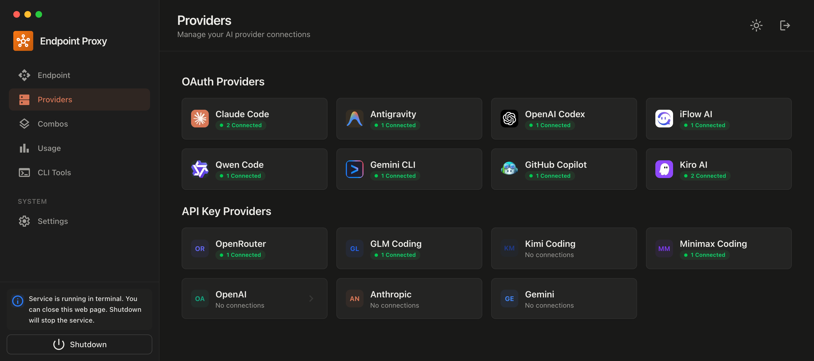

# OmniRoute Android

This repository will host the Android application that provides a native mobile interface to the **OmniRoute** AI gateway. The Android app will allow you to:

- Run OmniRoute locally on your Android device (Termux support).
- Connect to a remote OmniRoute server via the standard API.
- Manage providers, view dashboards, and trigger routing directly from the phone.

The core OmniRoute project lives at https://github.com/cheaper-inference/OmniRoute. This Android client will reuse the existing OmniRoute API and will be built with modern Android tooling (Kotlin, Jetpack Compose).

## Repository Structure

- `app/` – Android application source code (Kotlin, Compose).
- `assets/` – Static assets such as the OmniRoute logo.
- `README.md` – This file.

## Getting Started

1. Clone this repository.
2. Open the project in Android Studio.
3. Build and run on an Android device or emulator.

## Contributing

Contributions are welcome! Please follow the contribution guidelines of the main OmniRoute project and keep this repo focused on the Android client.

---

*Generated with [Claude Code](https://claude.com/claude-code)*
